# Captures and approved-photo shell update

Actual running Qt screens at 1672×941 and 1366×768, captured on Linux. The Windows workflow renders the same 13 pages before packaging.

Captures has an adjustable screenshot browser on the left and a much larger selected-image preview on the right. The image expands with the window. The photo family from the locked design is now used throughout the shell, including the other workspace headers. Oversized scanner illustrations and procedural cover posters were removed. Genuine local or owner-selected art remains; missing artwork uses a neutral state.

The images inside Captures are existing application screenshots used as explicit review fixtures. No private user screenshots or invented gameplay images are involved.

Runtime source: [`81ba576`](https://github.com/wrightausername/Game-Grave/commit/81ba576b9d1ead5f951445800cbdfcb3f627883f). [Capture provenance and hashes](visual-review.json). These changes do not declare complete 1:1 visual acceptance.

## Captures

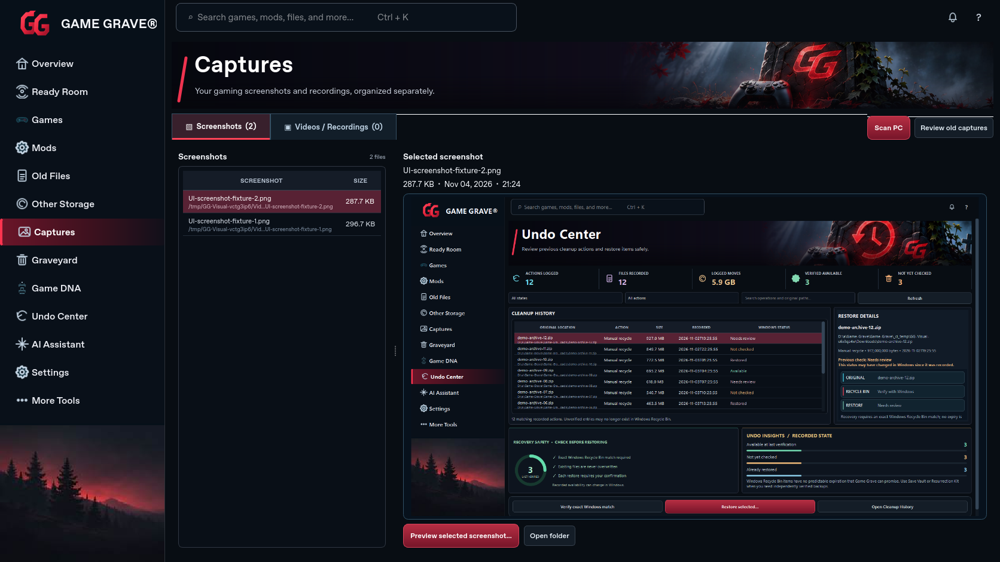

[1366×768 capture](visual-review-captures-1366.png)

## Overview

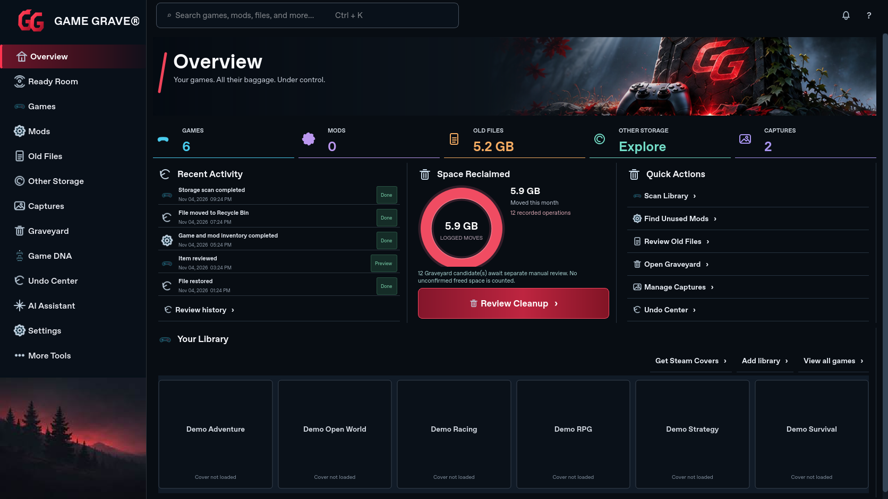

[1366×768 capture](visual-review-overview-1366.png)

## Ready Room

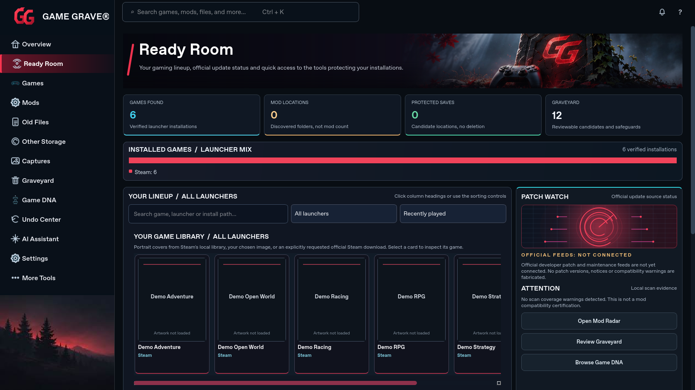

[1366×768 capture](visual-review-ready-room-1366.png)

## Games

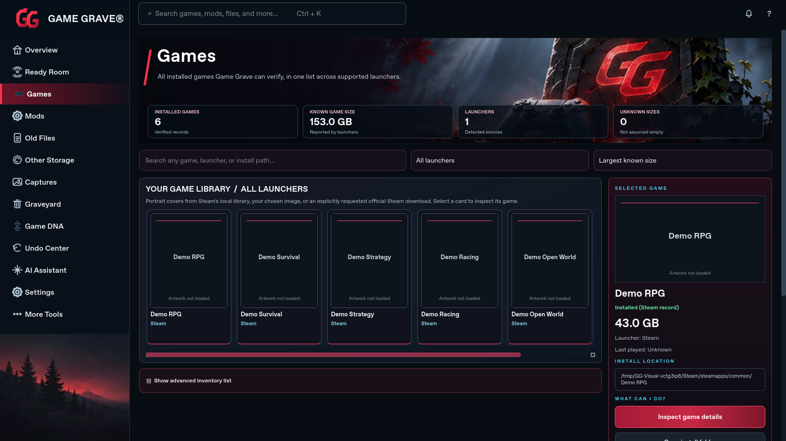

[1366×768 capture](visual-review-games-1366.png)

## Mods

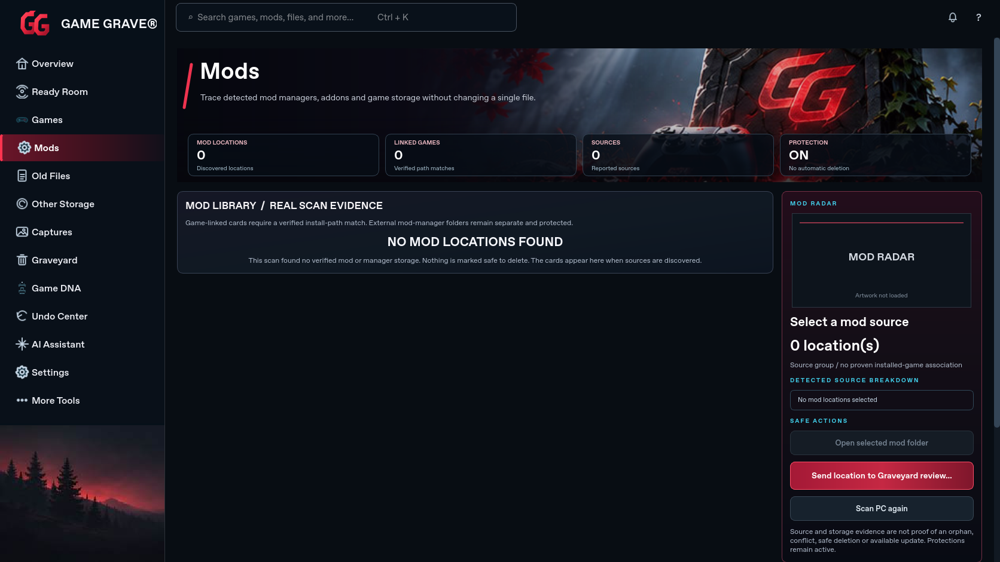

[1366×768 capture](visual-review-mods-1366.png)

## Old Files

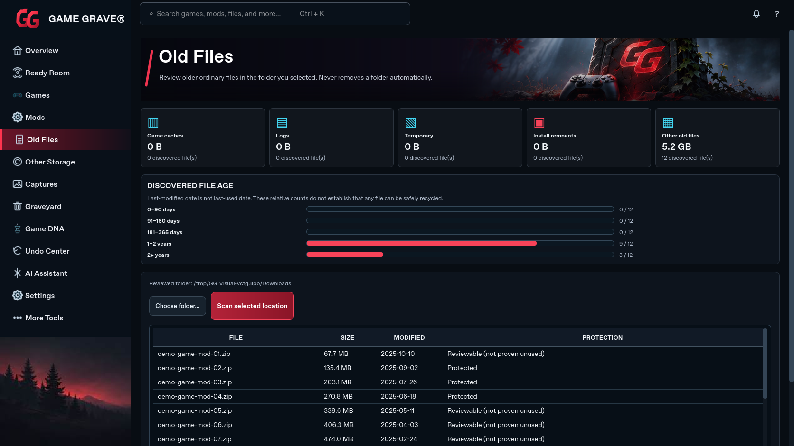

[1366×768 capture](visual-review-old-files-1366.png)

## Other Storage

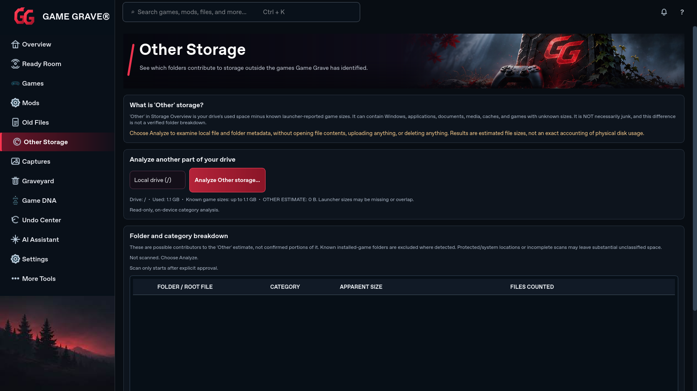

[1366×768 capture](visual-review-other-storage-1366.png)

## Graveyard

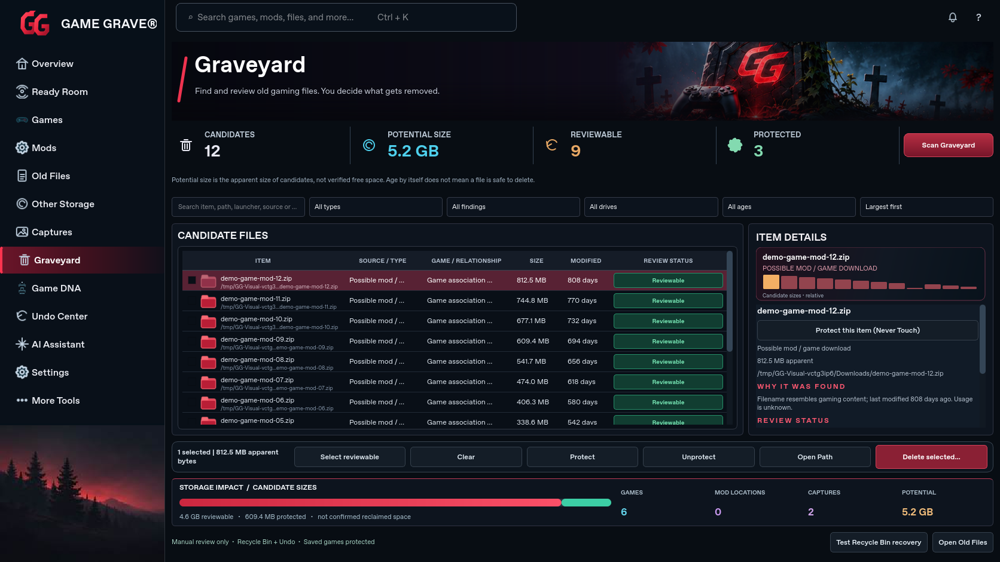

[1366×768 capture](visual-review-graveyard-1366.png)

## Game DNA

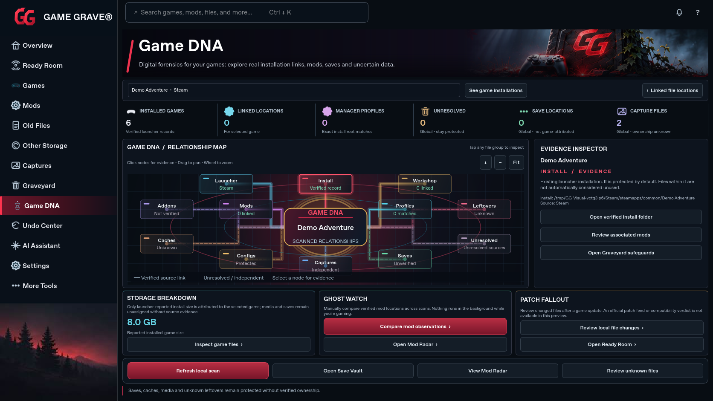

[1366×768 capture](visual-review-game-dna-1366.png)

## Undo Center

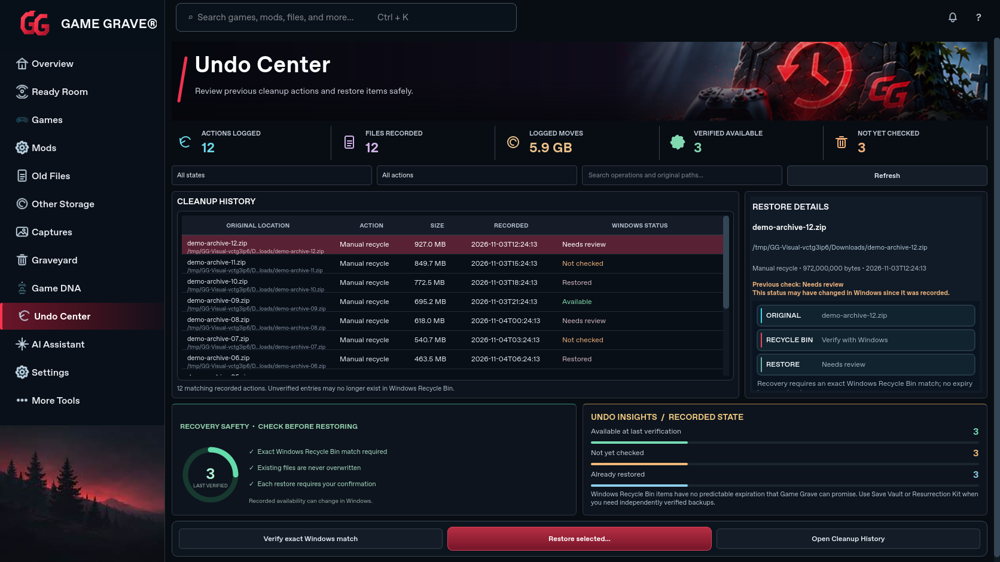

[1366×768 capture](visual-review-undo-center-1366.png)

## AI Assistant

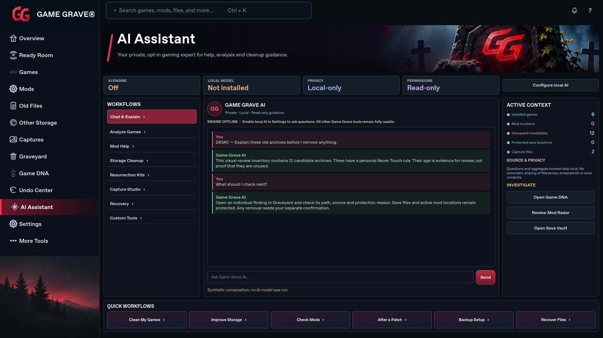

[1366×768 capture](visual-review-ai-assistant-1366.png)

## Settings

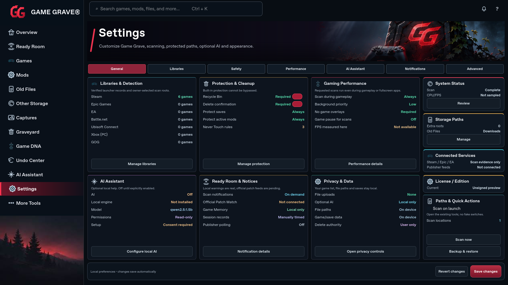

[1366×768 capture](visual-review-settings-1366.png)

## More Tools

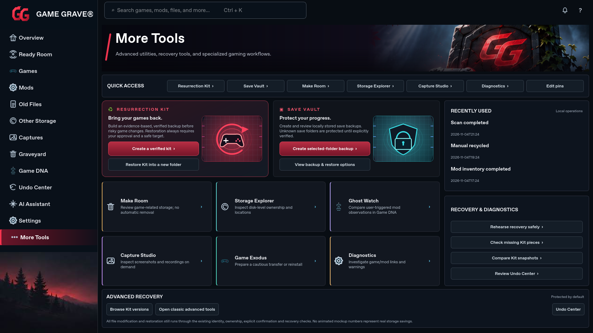

[1366×768 capture](visual-review-more-tools-1366.png)
