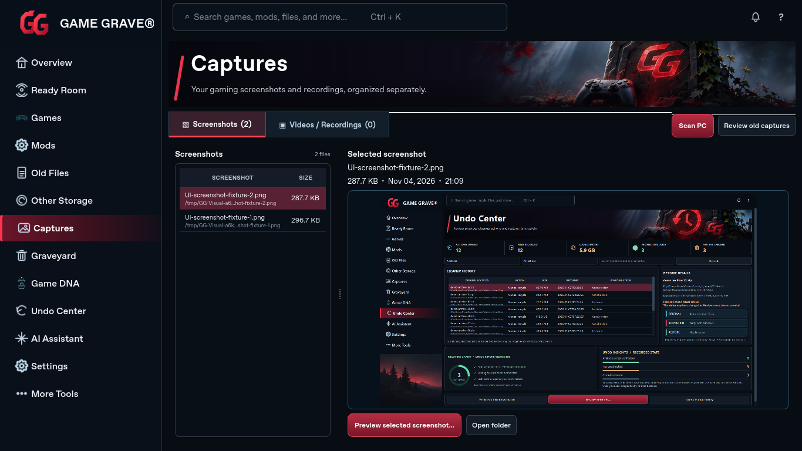

# Captures and artwork update

Actual running Qt screenshots at 1672×941 and 1366×768. Captured on Linux; the Windows workflow also renders these pages before packaging.

Captures now has an adjustable screenshot browser on the left and a much larger selected-image preview on the right. The preview grows with the window and retains image proportions. The existing forest/GG photo replaces the generic Captures illustration.

The images shown inside Captures are prior application screenshots used as an explicit review fixture, not the owner’s private screenshots or invented gameplay.

Procedural moon/forest cover posters were removed. Local publisher or owner-selected artwork is retained. Missing artwork uses a neutral state, and Overview exposes Get Steam Covers.

Runtime source: [`1debbee`](https://github.com/wrightausername/Game-Grave/commit/1debbee332cc50f631fe7c7caf6d7c9e6c86724a). [Capture provenance and hashes](visual-review.json). These targeted corrections do not declare full 1:1 visual acceptance.

## Captures — 1672×941

## Captures — 1366×768

## Overview missing-artwork state

## Game DNA without invented game art

