# Dashboard glow and Ready Room reference pass

Actual Qt application captures at 1672×941 and 1366×768, rendered on Linux from [`90256b3`](https://github.com/wrightausername/Game-Grave/commit/90256b3e0ce1a27c667325372fa0ee68ee6823e6). The Windows build independently renders all 13 routes before packaging.

[Implementation and exact artwork limits](../../OVERVIEW_READY_ROOM_REFERENCE_PASS.md) · [Capture provenance and hashes](visual-review.json)

Overview follows the newly supplied full-size reference: wider rail and larger type, original outline icons, a compact five-metric band, calibrated middle columns, real cover pagination, short cover tiles, static colored halos, a shaded red ring, restrained cleanup-button glow and reflections from verified artwork. The shell has working window controls and native dragging/resizing.

Ready Room follows the newly supplied panel composition: Patch Watch beside Your Games at a Glance; Mod Radar, Save Vault and System & Game Health beneath. The previous search/sort inventory is disclosed below and still drives both summary lists. Unknown feed, compatibility, health and backup states remain explicit.

**Artwork limitation:** the Ready Room workstation photograph is not available as an image file in the repository or mounted attachments. The Ready Room capture still uses the existing photo fallback. The dashboard photo is also a cropped strip, not the full new source. These captures do not certify a complete exact match to either original photograph. No generated replacement is being presented as the locked asset.

Review data is explicitly synthetic; there are no user files, real game screenshots, network fetches or AI inference. Missing game art remains neutral. Images inside Captures are earlier application screenshots used as fixtures.

Validation: 525 local tests, 3 platform-specific skips, including 16 Qt interaction/layout regressions. Native Windows UI, DPI, EXE and installer validation is recorded on PR #88 and the versioned public preview release.

## Overview

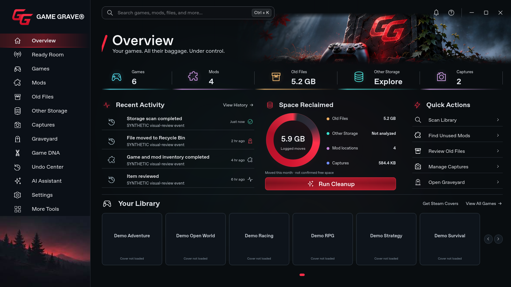

[1366×768 capture](visual-review-overview-1366.png)

## Ready Room

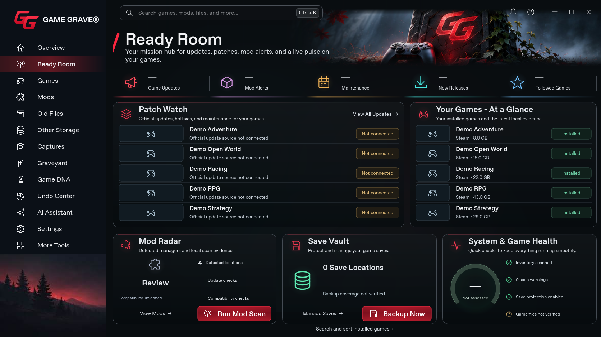

[1366×768 capture](visual-review-ready-room-1366.png)

## Games

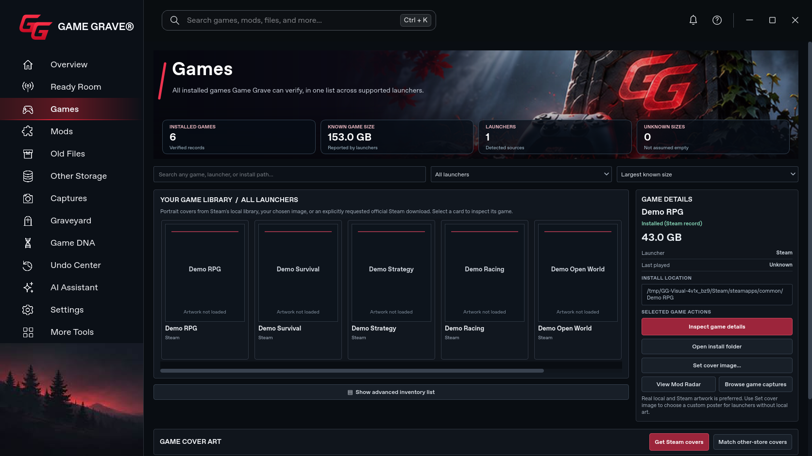

[1366×768 capture](visual-review-games-1366.png)

## Graveyard

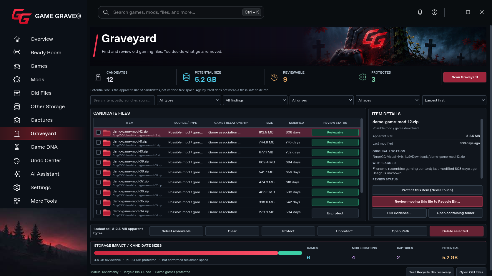

[1366×768 capture](visual-review-graveyard-1366.png)

## Game DNA

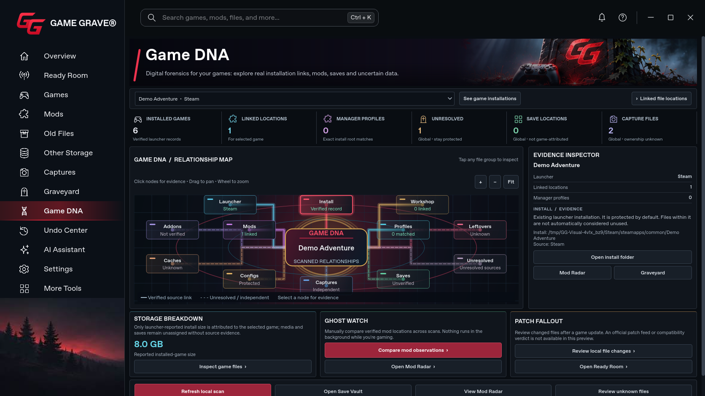

[1366×768 capture](visual-review-game-dna-1366.png)

## Undo Center

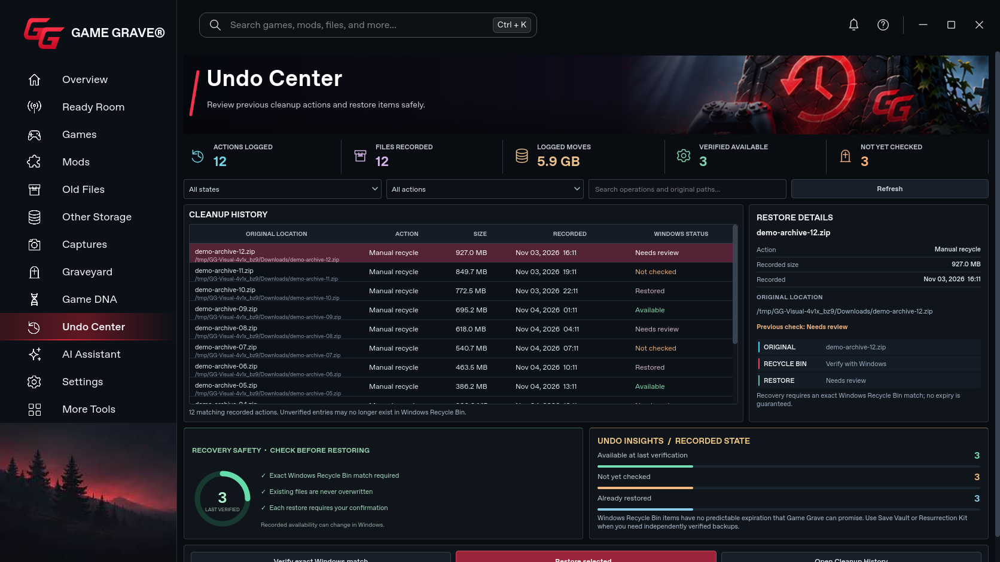

[1366×768 capture](visual-review-undo-center-1366.png)

## AI Assistant

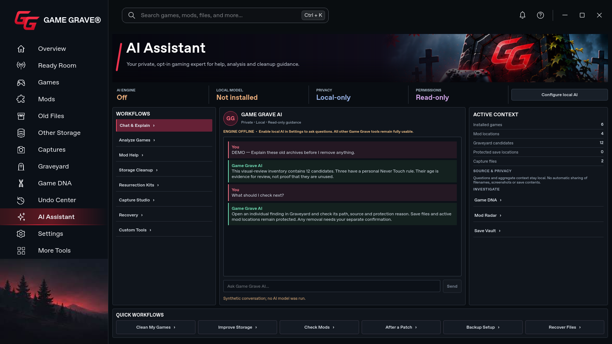

[1366×768 capture](visual-review-ai-assistant-1366.png)

## Settings

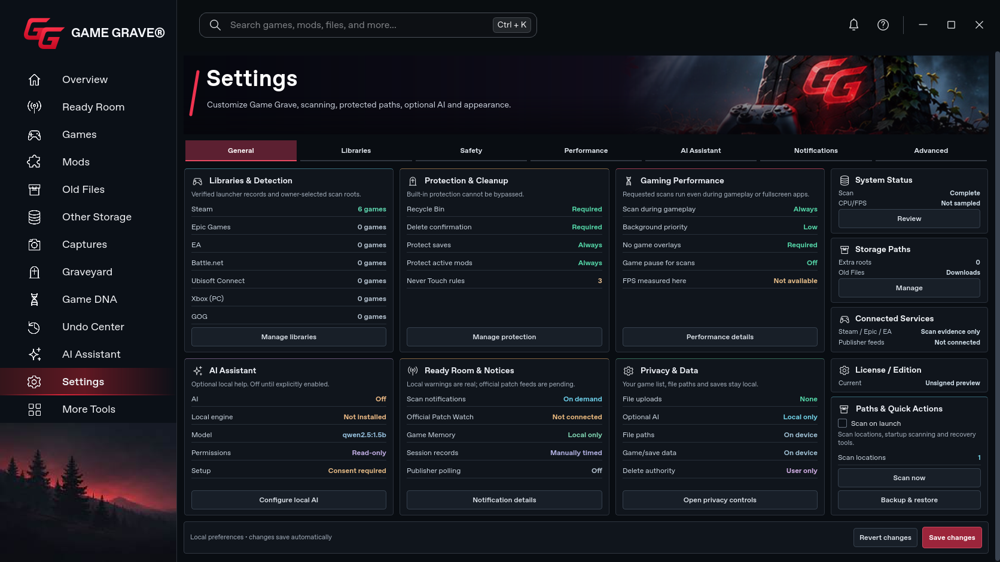

[1366×768 capture](visual-review-settings-1366.png)

## More Tools

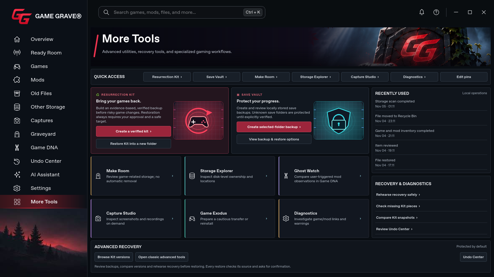

[1366×768 capture](visual-review-more-tools-1366.png)

## Captures

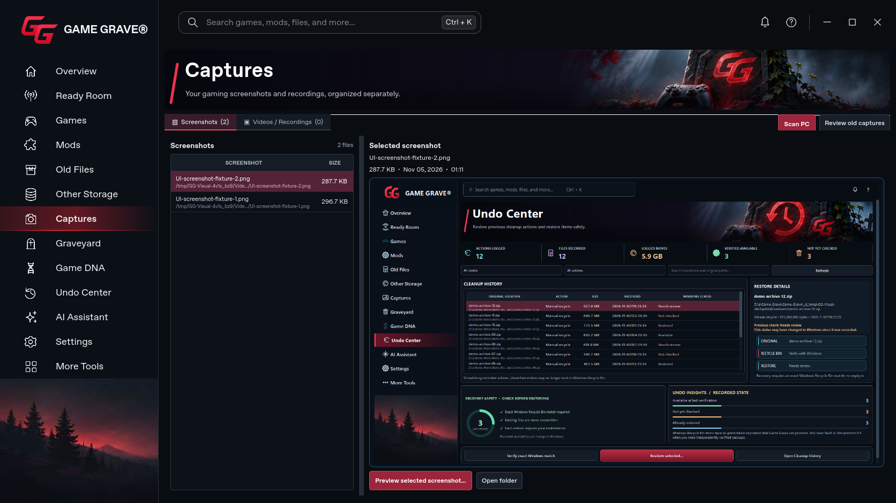

[1366×768 capture](visual-review-captures-1366.png)

## Mods

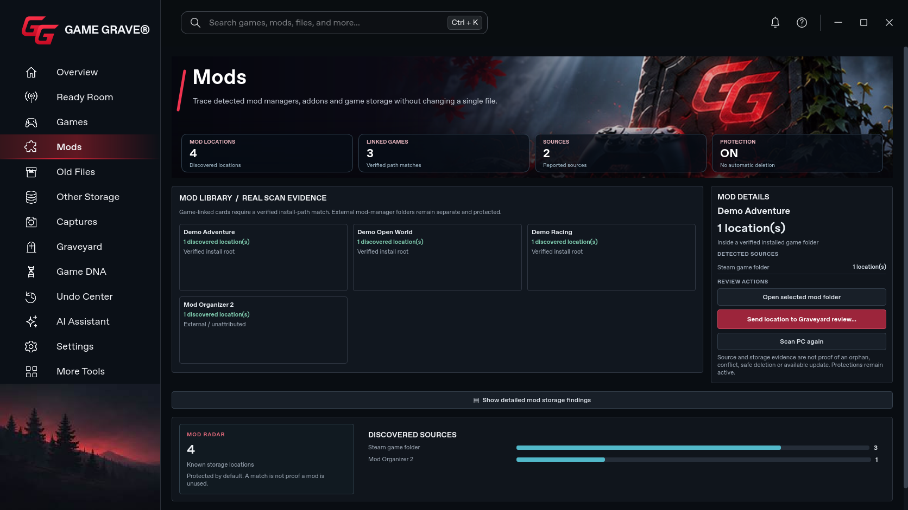

[1366×768 capture](visual-review-mods-1366.png)

## Old Files

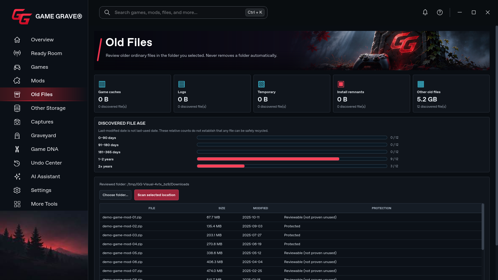

[1366×768 capture](visual-review-old-files-1366.png)

## Other Storage

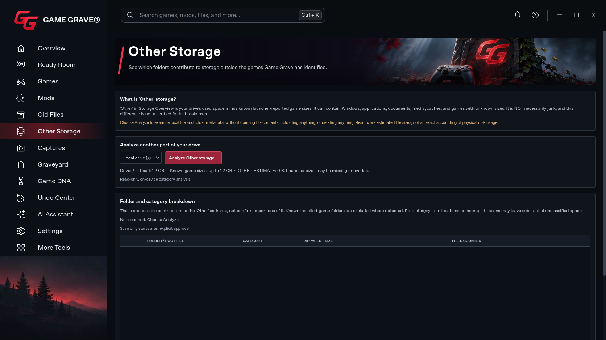

[1366×768 capture](visual-review-other-storage-1366.png)
