# Locked-reference interior and side-panel implementation

Running Qt application captures at 1672×941 and 1366×768. This gallery was rendered on Linux from runtime source [`1748625`](https://github.com/wrightausername/Game-Grave/commit/17486250dd04ae7421be1375ce31ef9ccf1a0c41); the Windows workflow independently renders the same pages before packaging the installer. [Capture provenance and SHA-256 hashes](visual-review.json).

The reference is the owner's seven-page comparison, left column, and the existing locked visual contract. The supplied original photographic header crops remain in use. This pass changes interiors and contextual panels:

- One consolidated charcoal stylesheet replaces the accumulated conflicting preview styles. Controls, tables, dialogs, tabs and side panels share the same compact scale, restrained borders and red action states.
- Graveyard separates scrollable source evidence from always-visible item actions. The table keeps size and review state visible when resized.
- Game DNA groups launcher and selected-game facts beside node evidence, with a larger map workspace and compact investigation links.
- Undo Center aligns operation facts, readable timestamps, original location and a compact Windows recovery route.
- AI Assistant uses the reference's workflow / conversation / context proportions, aligned inventory facts and investigation links.
- Settings retains seven section tabs with three main columns and a compact status column, aligned factual rows and real existing controls.
- More Tools has denser recent-use records and contextual recovery links alongside the two featured utilities and six tool tiles.
- Games and Mods use the same contextual panel design, with verified local artwork when available. Missing artwork no longer occupies a large inspector placeholder.
- Overview places library controls beside the section title; Captures retains the left browser and expanded right preview requested by the owner.

The fixture includes disposable games, mod locations, candidate files, recovery records and a synthetic conversation. No user files, game screenshots, network calls or AI inference are involved. Images within Captures are older real application captures used as test input. Real installations display real discovered records and verified artwork.

Validation: 522 tests, 3 skipped on Linux; 13 native Qt interaction/layout tests included. Layouts are also exercised at 1040×720. Final Windows DPI, EXE and installer evidence is recorded on PR #88 and the public preview release.

These are actual implementation screenshots for review, not a declaration of pixel-identical acceptance. Full original approved page PNGs remain referenced in the locked contract; the available comparison does not support a machine pixel-difference measurement.

## Overview

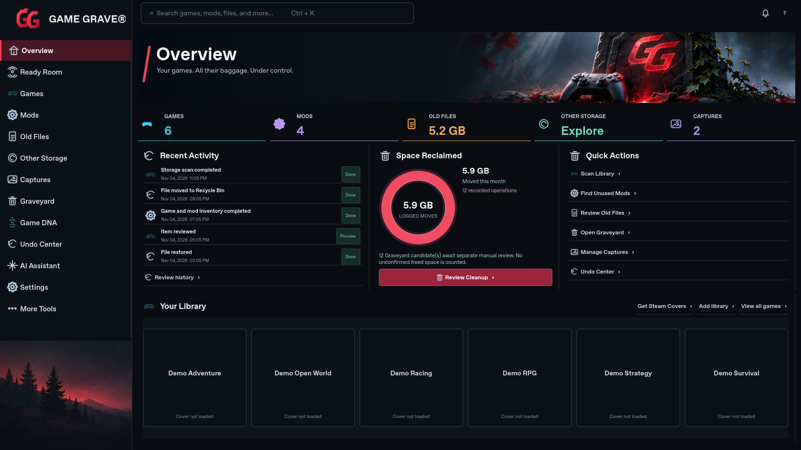

[1366×768 capture](visual-review-overview-1366.png)

## Graveyard

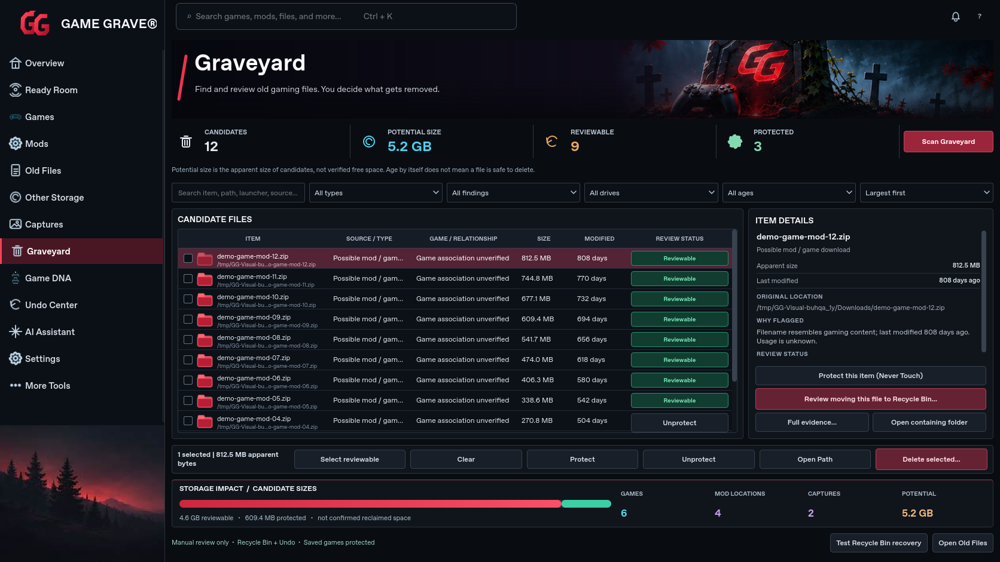

[1366×768 capture](visual-review-graveyard-1366.png)

## Game DNA

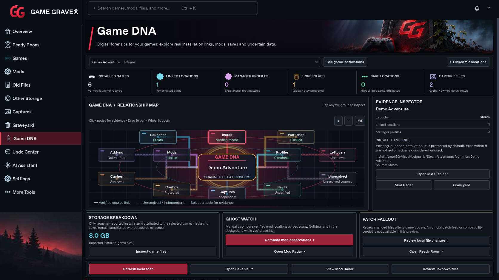

[1366×768 capture](visual-review-game-dna-1366.png)

## Undo Center

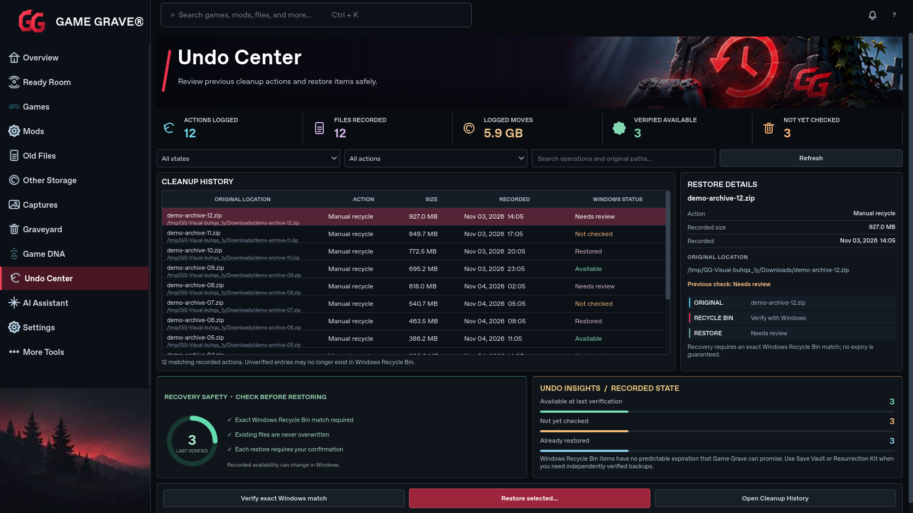

[1366×768 capture](visual-review-undo-center-1366.png)

## AI Assistant

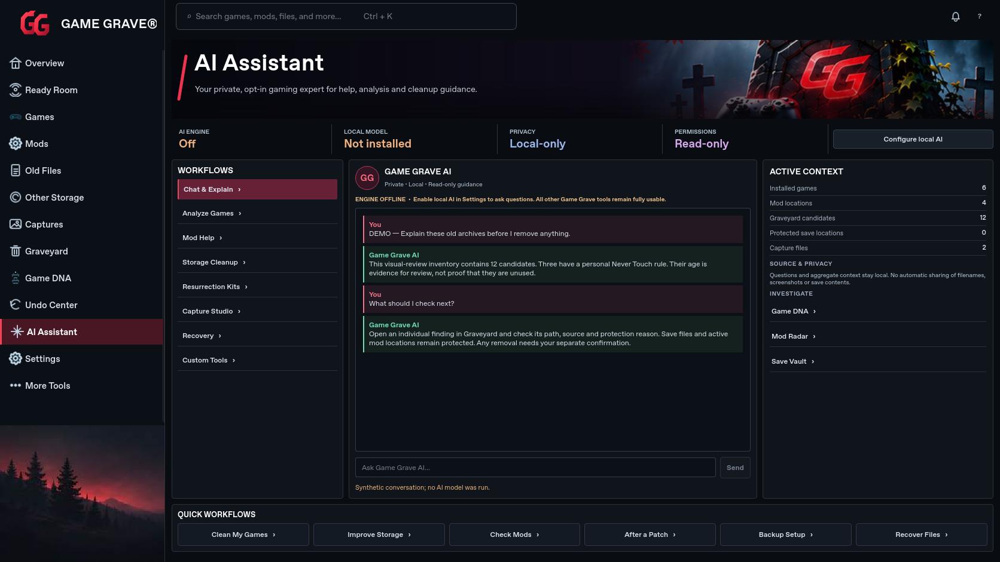

[1366×768 capture](visual-review-ai-assistant-1366.png)

## Settings

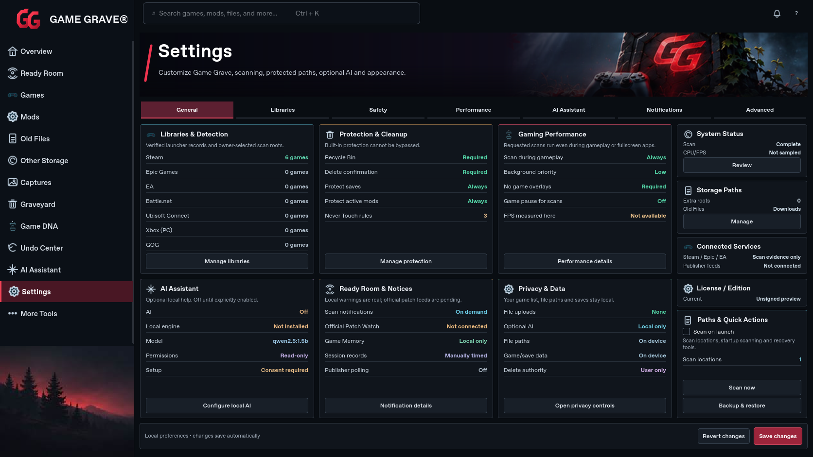

[1366×768 capture](visual-review-settings-1366.png)

## More Tools

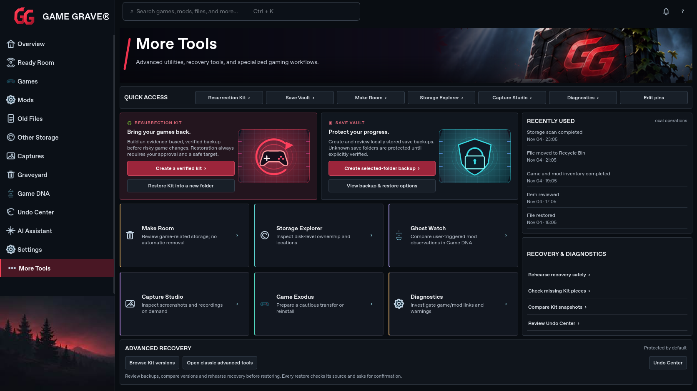

[1366×768 capture](visual-review-more-tools-1366.png)

## Games

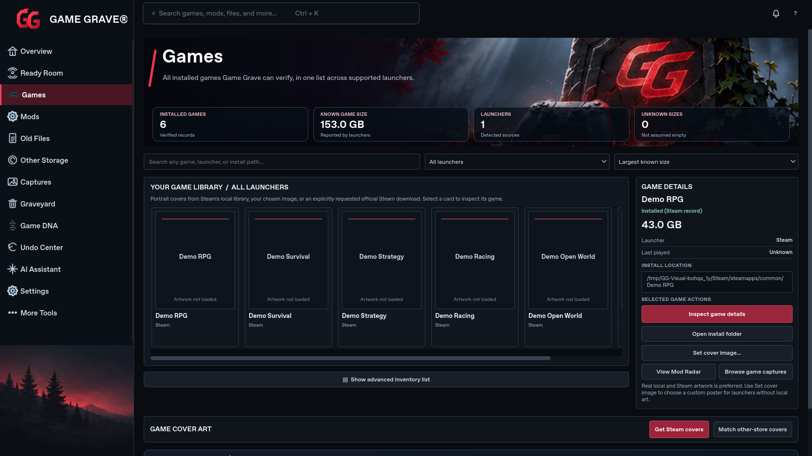

[1366×768 capture](visual-review-games-1366.png)

## Mods

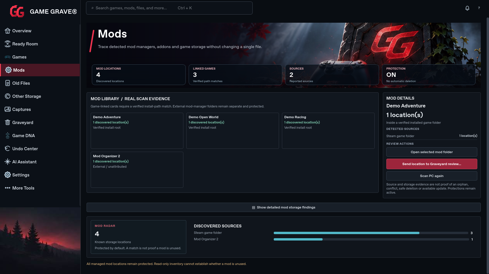

[1366×768 capture](visual-review-mods-1366.png)

## Captures

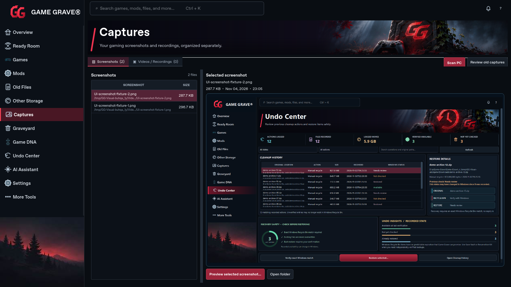

[1366×768 capture](visual-review-captures-1366.png)

## Ready Room

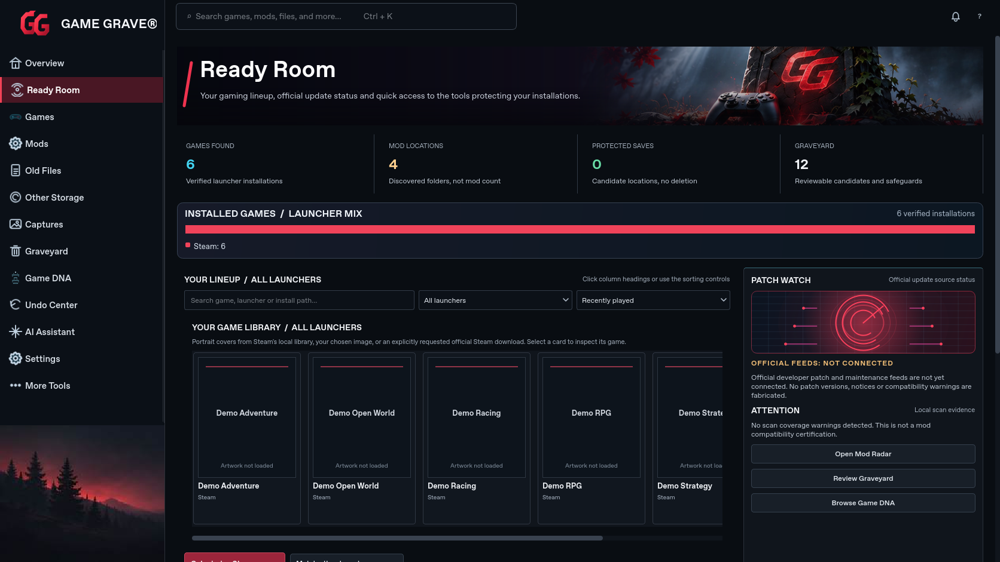

[1366×768 capture](visual-review-ready-room-1366.png)

## Old Files

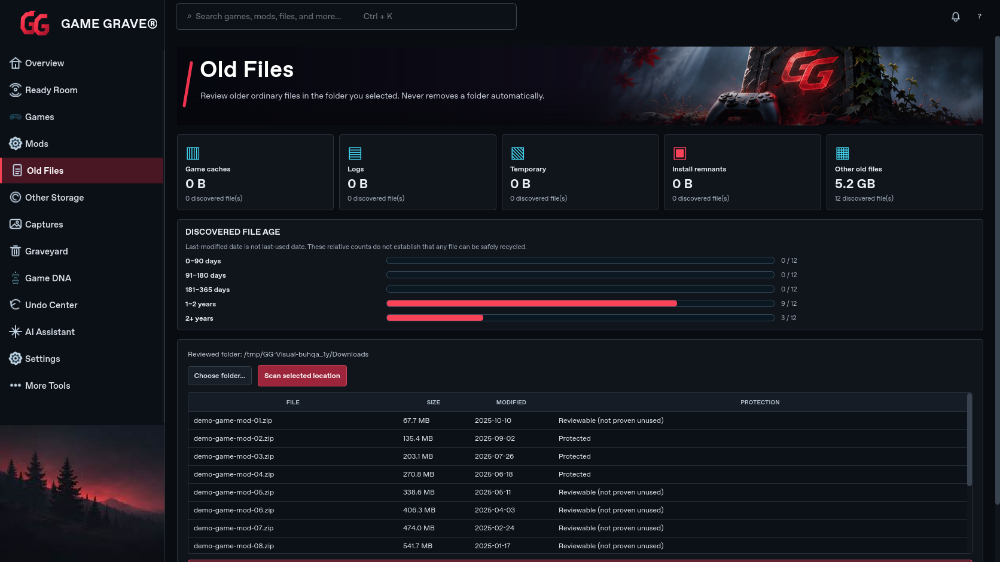

[1366×768 capture](visual-review-old-files-1366.png)

## Other Storage

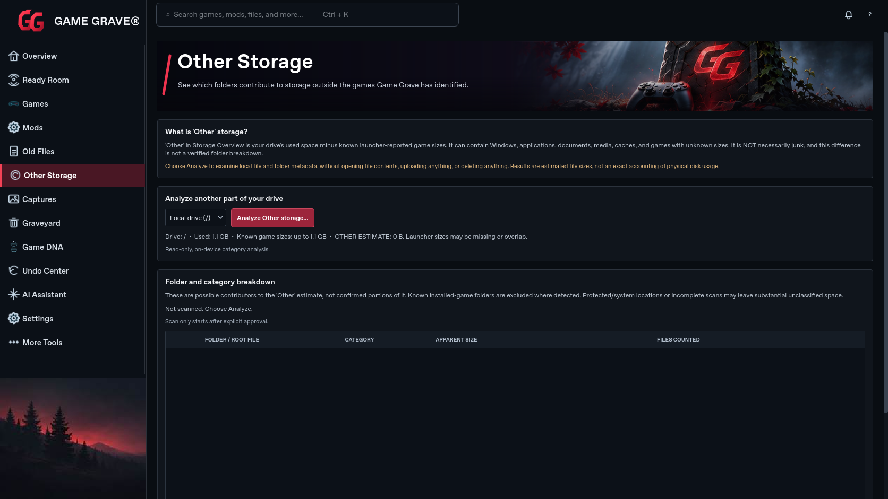

[1366×768 capture](visual-review-other-storage-1366.png)
