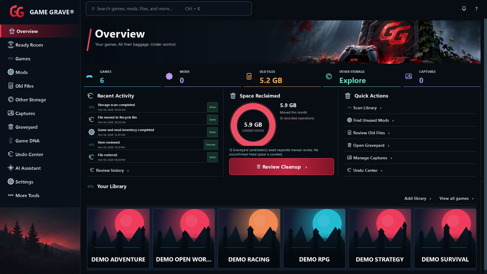
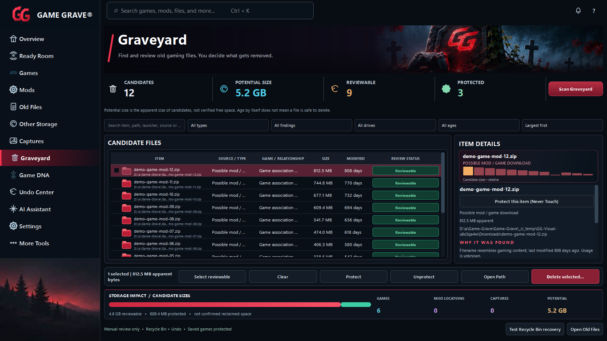
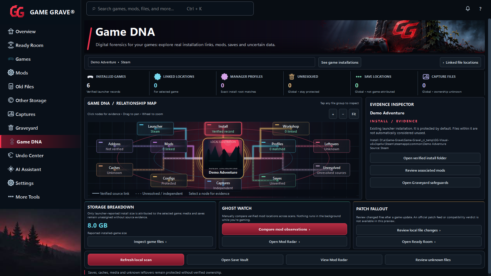
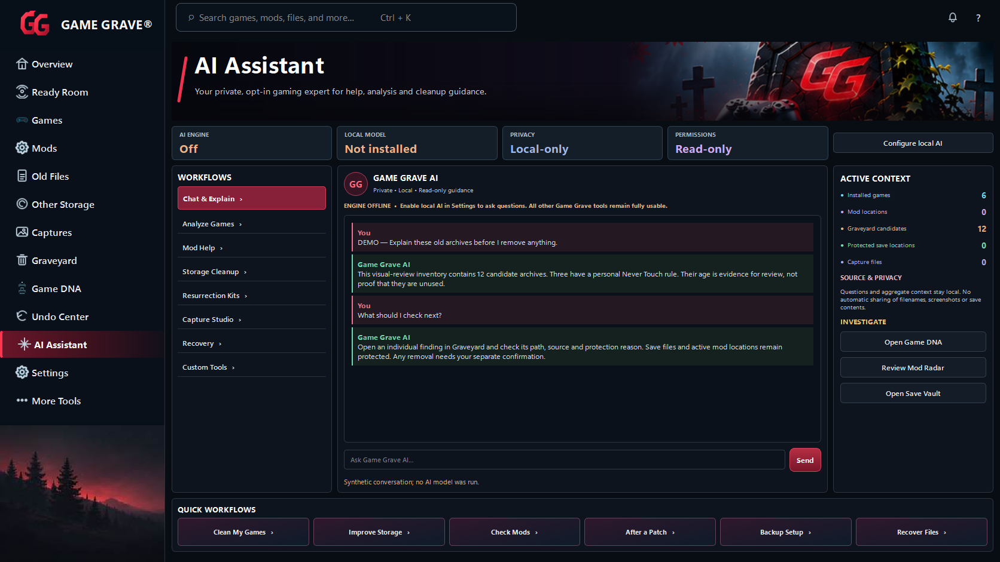
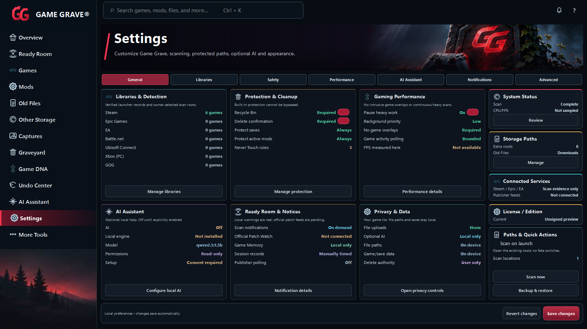
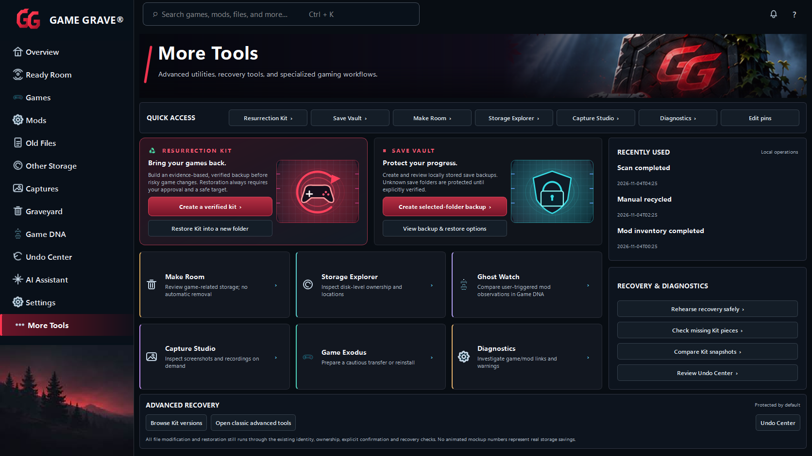

# Implemented Game Grave UI — native Windows review

These are actual Windows captures of the running Qt application after the visual pass against the owner’s seven-page comparison (left column). The original agreed photo crops are displayed by production widgets.

All seven pages were rendered at 1672×941 and 1366×768. Inventory, recovery records, activity and conversation are explicitly synthetic review fixtures; no user files or AI inference were involved. Demo covers use local illustrations. Production loads verified local publisher art when available.

[Windows UI, scaling and capture verification](https://github.com/wrightausername/Game-Grave/actions/runs/41772920325) · [Windows capture provenance and hashes](windows/visual-review.json) · [Earlier Linux renders](linux-review.md)

Validated runtime source: [`47cc1ba`](https://github.com/wrightausername/Game-Grave/commit/47cc1ba26e31a8efb299f049060246e3d66ebeaa). Later commits publish review evidence. Tests and these screenshots do not certify exact 1:1 pixel parity with the original full-resolution approved PNGs.

## Overview

[1366×768 Windows capture](windows/visual-review-overview-1366.png)

## Graveyard

[1366×768 Windows capture](windows/visual-review-graveyard-1366.png)

## Game DNA

[1366×768 Windows capture](windows/visual-review-game-dna-1366.png)

## Undo Center

[1366×768 Windows capture](windows/visual-review-undo-center-1366.png)

## AI Assistant

[1366×768 Windows capture](windows/visual-review-ai-assistant-1366.png)

## Settings

[1366×768 Windows capture](windows/visual-review-settings-1366.png)

## More Tools

[1366×768 Windows capture](windows/visual-review-more-tools-1366.png)
