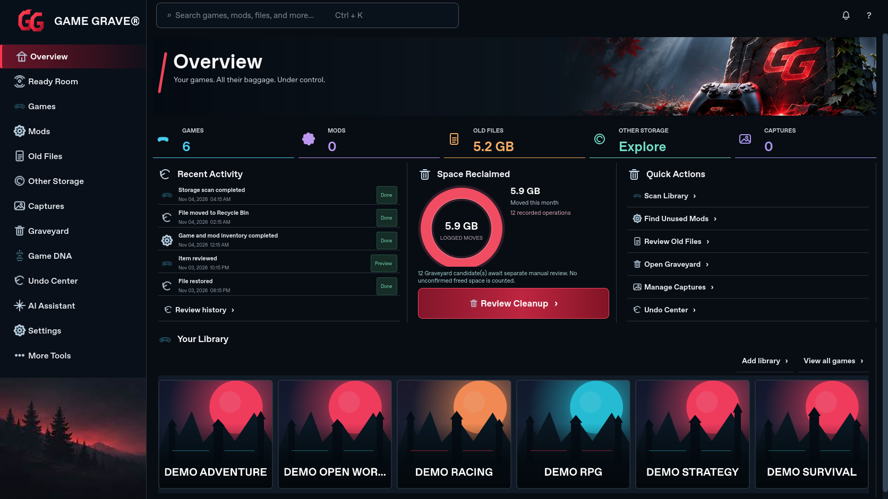
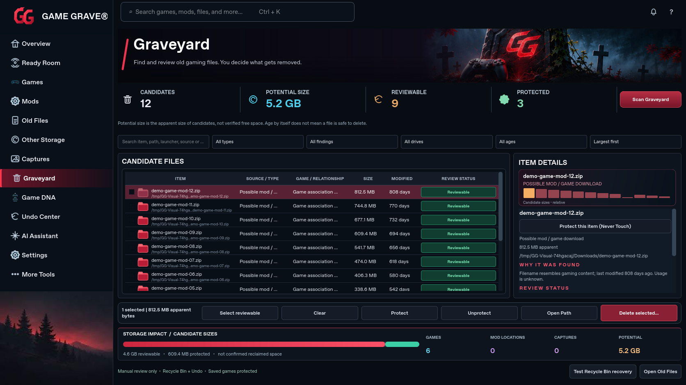
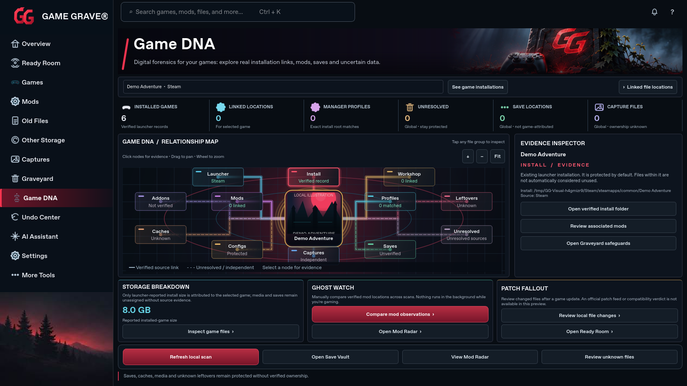
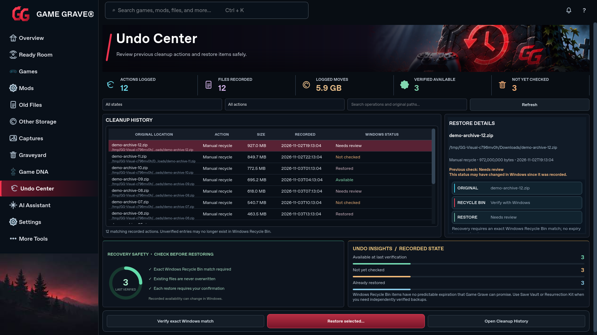
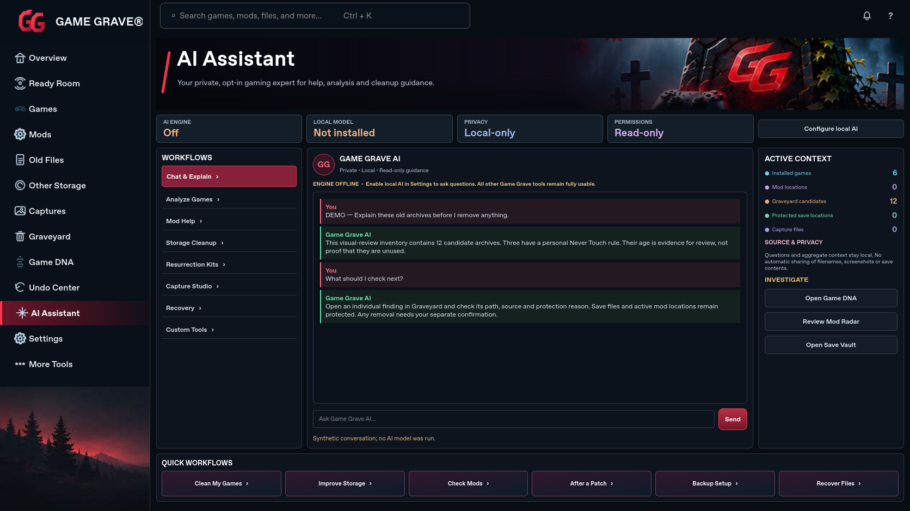
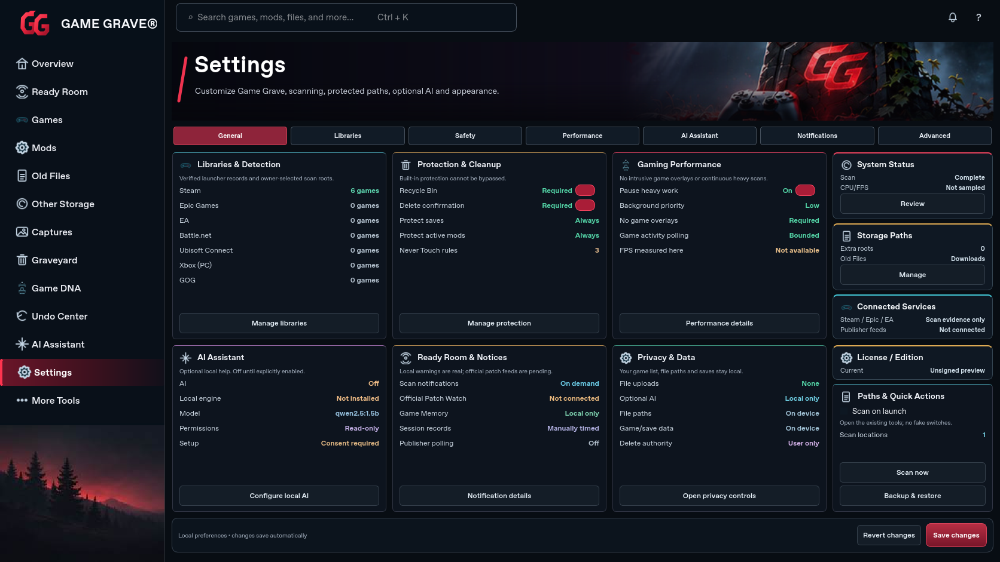
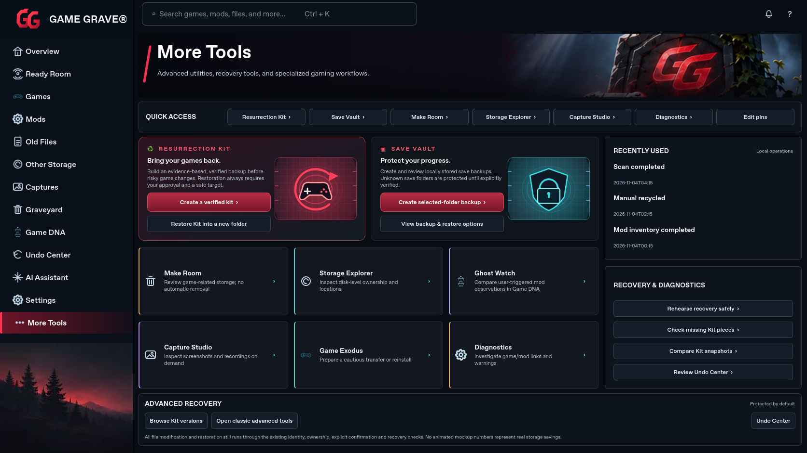

# Implemented Game Grave UI — November 4 review

These are captures of the running native Qt application after the visual pass against the owner’s seven-page comparison (left column). They are not design mockups. The original agreed photo crops are loaded by the production widgets.

Captured on Linux with Qt 6.11.3 at 1672×941 and 1366×768. Inventory, recovery records, activity and conversation use an isolated synthetic review fixture; no user files or AI inference were involved. Demo covers are local illustrations. Production uses verified local publisher artwork when available. Native Windows captures are also produced by the PR’s Crimson preview workflow.

Source implementation: [`47cc1ba`](https://github.com/wrightausername/Game-Grave/commit/47cc1ba26e31a8efb299f049060246e3d66ebeaa). [Capture provenance and hashes](visual-review.json). Tests and these screenshots do not certify exact 1:1 pixel parity with the original full-resolution approved PNGs.

## Overview

[1366×768 capture](visual-review-overview-1366.png)

## Graveyard

[1366×768 capture](visual-review-graveyard-1366.png)

## Game DNA

[1366×768 capture](visual-review-game-dna-1366.png)

## Undo Center

[1366×768 capture](visual-review-undo-center-1366.png)

## AI Assistant

[1366×768 capture](visual-review-ai-assistant-1366.png)

## Settings

[1366×768 capture](visual-review-settings-1366.png)

## More Tools

[1366×768 capture](visual-review-more-tools-1366.png)
