# Locked-photo restoration

The owner's photos remain the specification. Earlier plain-table previews were
the wrong baseline. This correction restores the original cinematic shell and
native page compositions from the earlier implementation and connects the
completed controllers to them.

The following captures are from the running Qt app at 1280×720 on Linux/offscreen,
using disposable QA libraries. Counts, paths and evidence reflect those fixtures;
they are not fabricated live user data. Windows produces its own native captures
in the build artifact. The Ready Room capture uses its explicitly labeled sample
mode. Native rendering checks do not replace the owner's visual judgment.

| Page | Original owner photo | Running app |
| --- | --- | --- |
| Games | 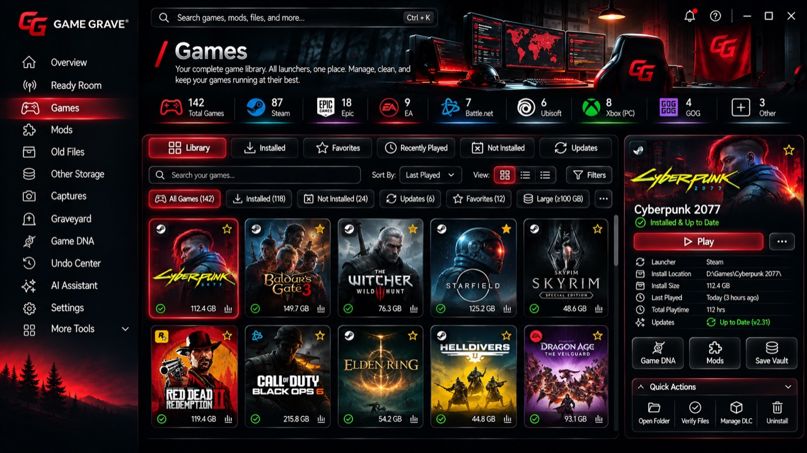 | 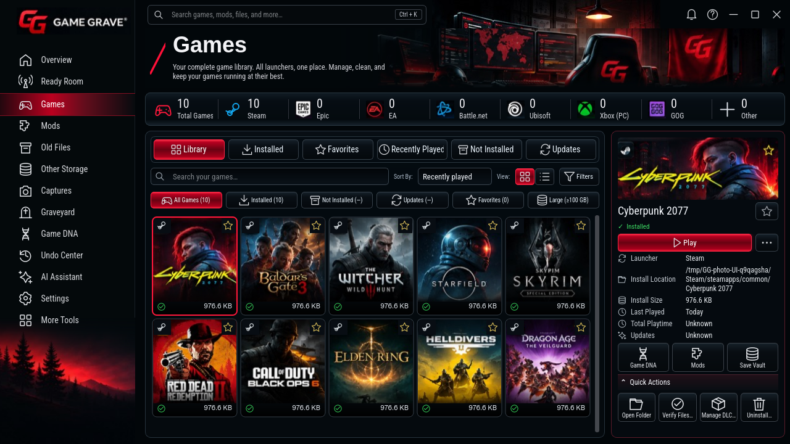 |
| Mods | 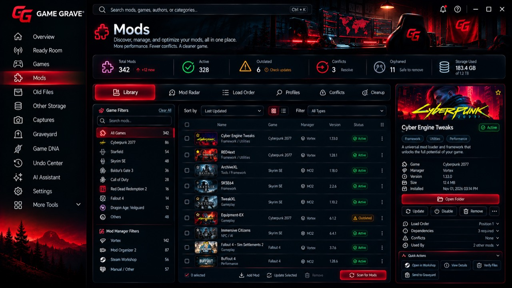 | 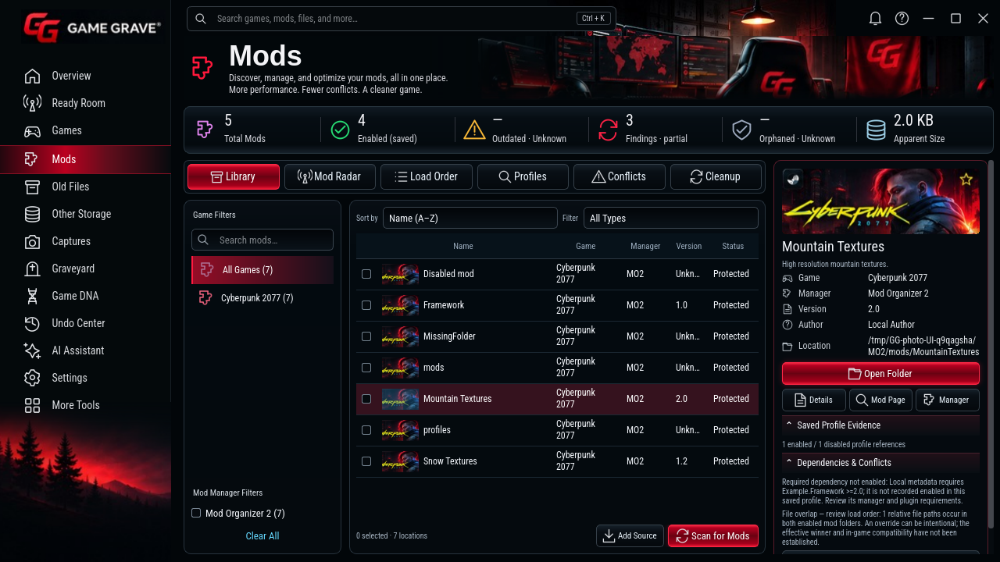 |
| Old Files | 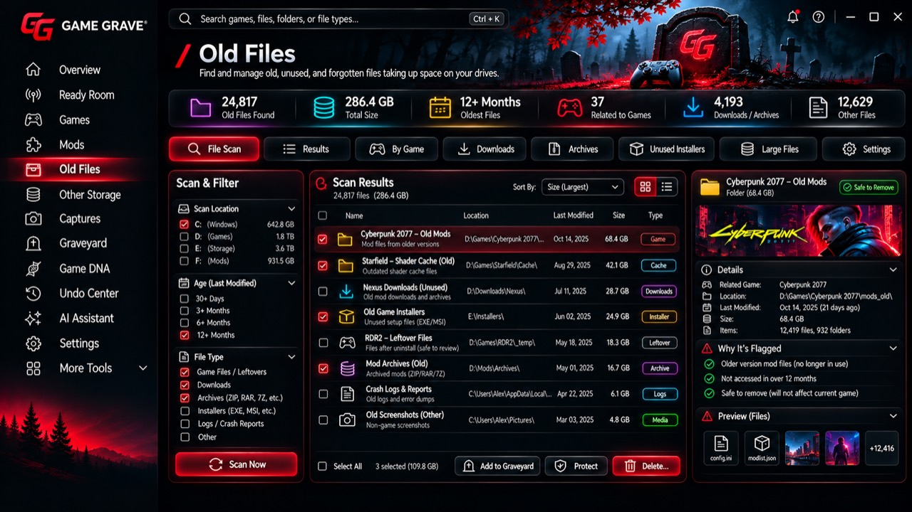 | 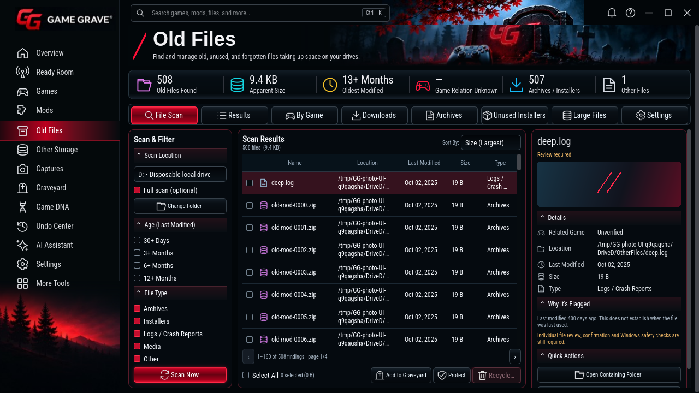 |
| Other Storage | 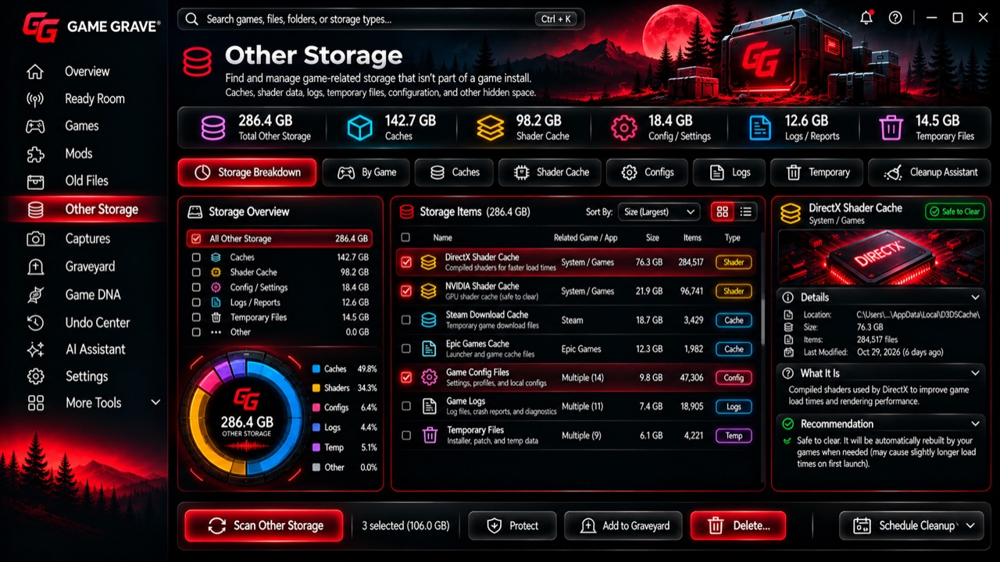 | 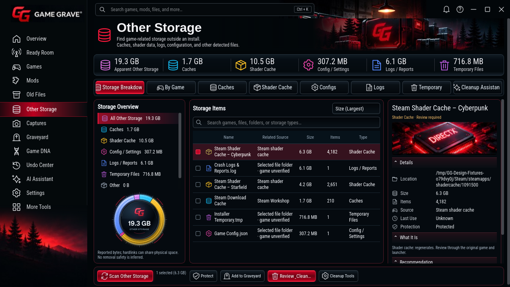 |
| Captures | 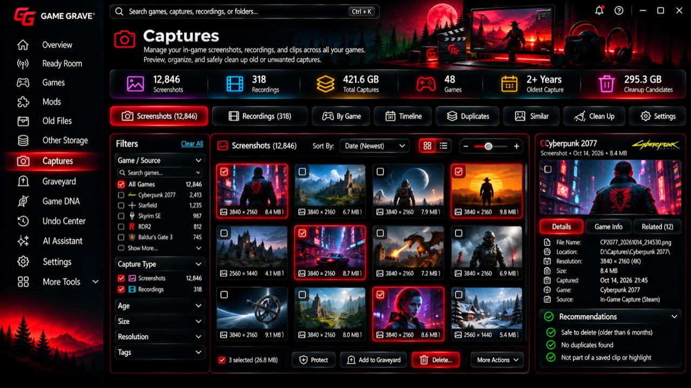 | 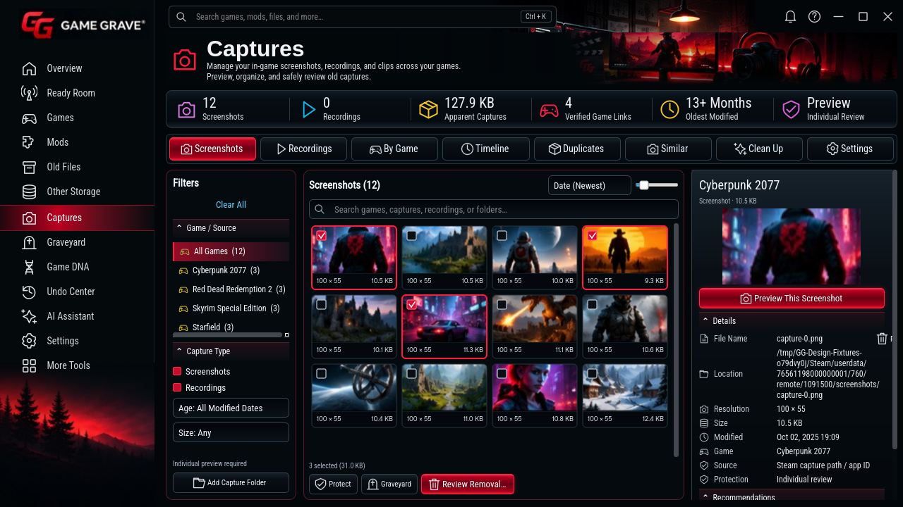 |
| Graveyard | 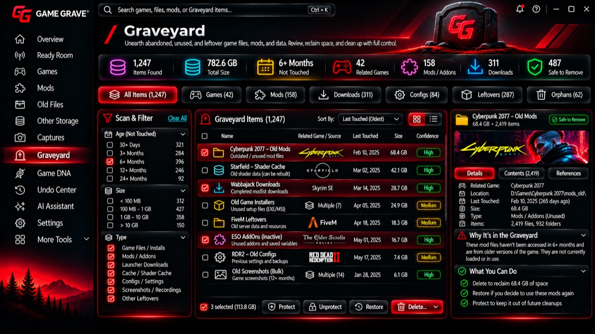 | 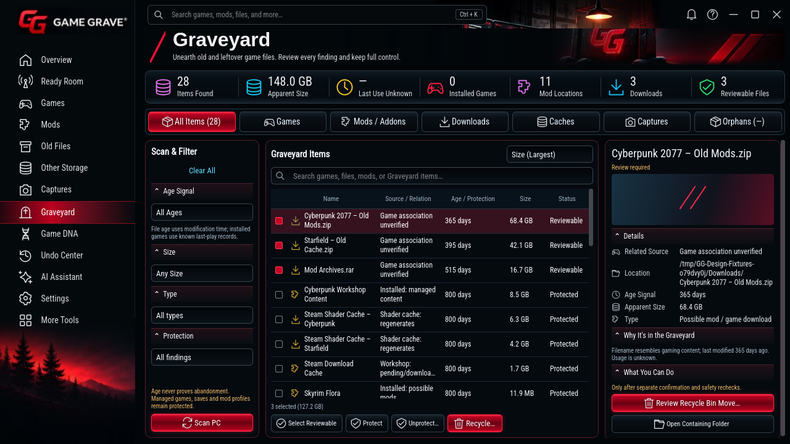 |
| Game DNA | 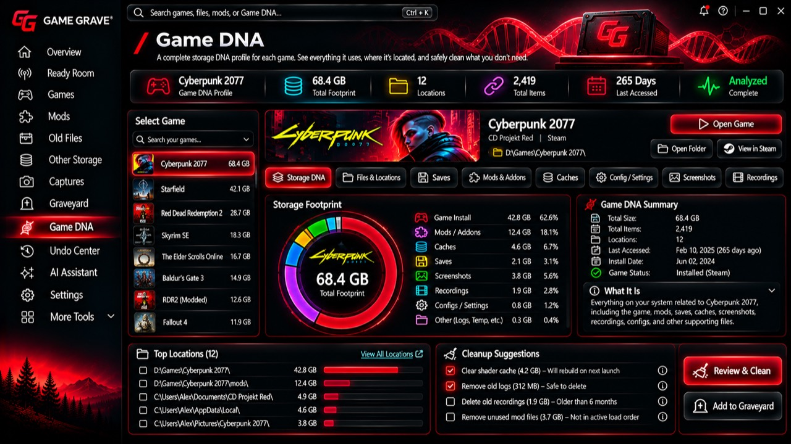 | 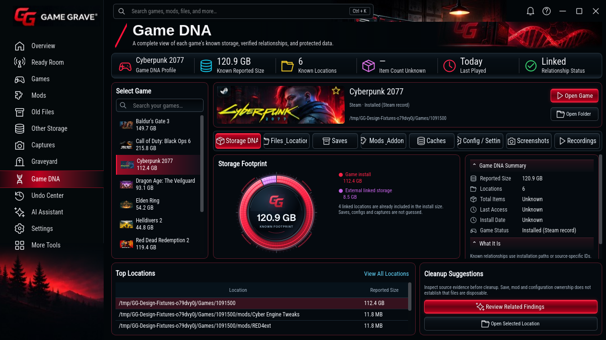 |
| Undo Center | 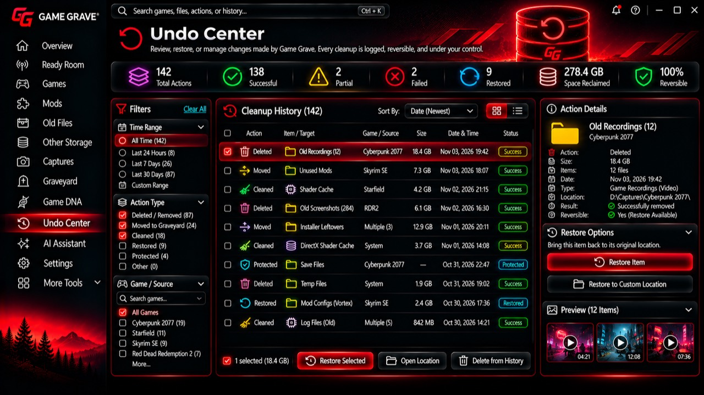 | 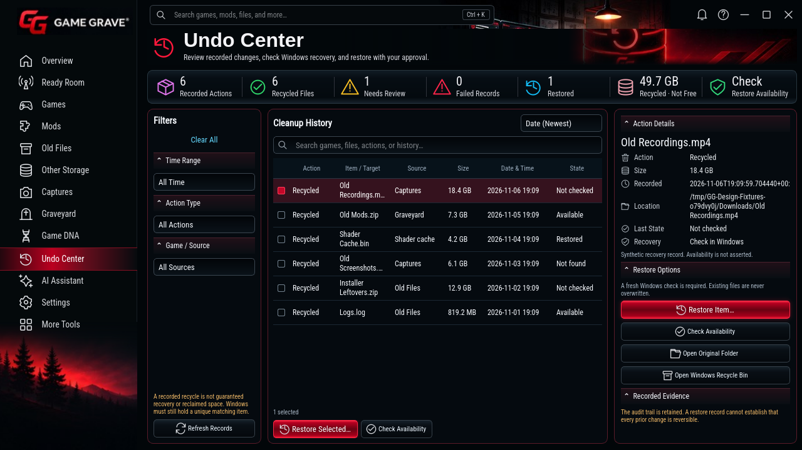 |

Ready Room's original is attached in the owner's conversation. Its actual native
render is [here](ready-room-reference-1280.png). Overview's original header crop
was recoverable, along with the original dashboard composition; its native
render is [here](overview-1280.png). A full Overview photo is not present locally.

All eight full photos are byte-identical to commit
`25f5955583b3d7a596a8f50cba9cf2bf9b9d17cb`; their checksum manifest is in the
reference directory. `photo_reference_guard.py` verifies those original bytes
and the existing safety/data engines. `photo_ui_smoke.py` exercises the cover
grid, game actions, mod hover/conflict tools, drive/full scan, paging, cancellation,
protected manual review and confirmed recycling through disposable transports.
It also checks all thirteen routes and 1280, 1440 and 960-pixel windows.

The Windows download includes `Compare-Locked-Photos.html`, the unmodified
originals, native Windows captures, both EXEs, checksums and source build identity.

Local validation: 495 unit tests passed, with one skipped; the photo integration,
original-photo/data guard and live Ready Room news/backup checks passed.
