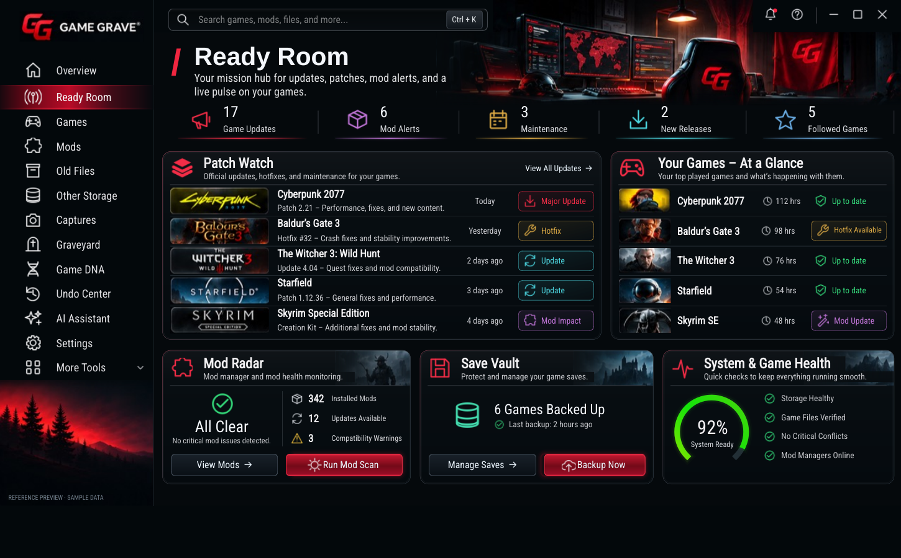
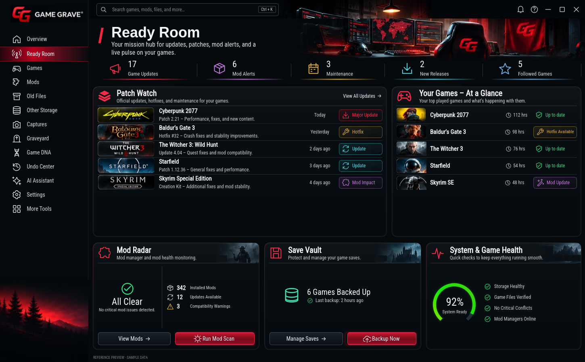

# Ready Room native scale — 0.2.9

The owner reopened Ready Room specifically to fix its zoomed appearance relative
to the other tabs. The approved artwork, card arrangement and actions remain the
foundation. No other tab or shared app implementation was changed.

At 1450×900 the previous Ready Room multiplied the whole interface by 1.1328.
Its separate sidebar was about 248 pixels wide, while the app's normal sidebar
was 219 pixels. It also substituted its own header, fonts and navigation.
The replacement uses normal Qt widgets inside the existing shell: a 219-pixel
sidebar and 46-pixel header remain in place on every tab.

| Previous Ready Room | Corrected Ready Room |
| --- | --- |
|  |  |

The [unchanged Games shell at the same window size](games-shell-1450.png) provides
a direct comparison. These are actual Qt captures on Linux/offscreen with
explicitly labeled sample data. Windows produces its own native captures.

Ready Room no longer resizes the window, hides/replaces the shared chrome,
changes the global search widget or reparents scan progress. Rows keep a normal
height while the cards adapt to the window. Smaller windows stack sections and
scroll, keeping text and buttons at their normal readable sizes.

The UI check clicks between Games and Ready Room repeatedly at five sizes and
verifies identical shell dimensions, fonts and icons. Panel clicks, live refresh,
wheel and Ctrl+wheel must not zoom or resize the app. Native window controls,
search, shortcuts, existing actions and reaching the compact footer are checked.
The live test retains verified ZIP backup/news/follow/game-selection coverage.

All twelve other tabs passed 72 pixel-identical comparisons against the locked
commit c636b60519b20e37afceb45d7fbb177a08e0188f. Every desktop runtime file and
asset outside the two Ready Room presentation files remains unchanged, including
the shared app, theme, icons, controllers and safety/data engines.

Ready Room's scaling correction is awaiting renewed owner signoff.
