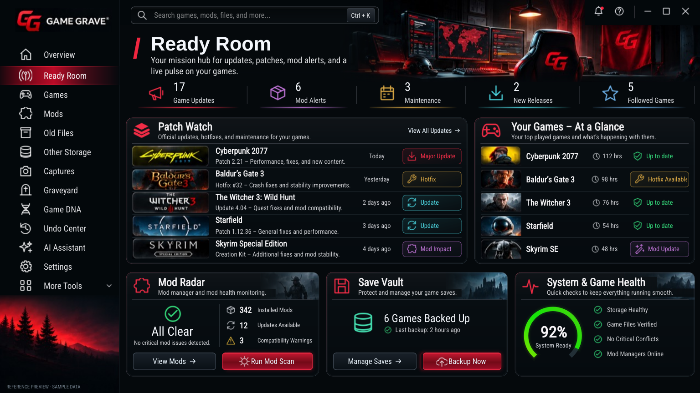

# Ready Room only — 0.2.8

Ready Room is the only active tab. The owner's attached 1536×864 mockup is the
specification. These are captures of native working Qt controls; no whole-page
screenshot substitutes for the interface.

The page uses one 1280×720 reference coordinate system. At 1536×864 it scales by
1.2, including the sidebar, fonts, header artwork, metric band, Patch Watch,
game rows and three lower cards. Patch Watch starts at (276,258), the coordinate
in the attached mockup. The reference preview uses explicitly labeled sample
values; normal operation retains real inventory, cached news and backup history.

The eight source photo files, all other desktop artwork and every other tab's
source remain unchanged. The only shared app change releases Ready Room's
temporary shell before building the next page.

The Ready Room UI smoke validates geometry at 1280×720, 1536×864, 1440×810 and
960×650, actual mouse targets through the scaled view, search, shortcuts, metric
and row actions, scan/backup routing, window controls and shell restoration.
The live smoke checks real disposable ZIP creation/verification, backup history,
explicit news refreshes, follows and exact game selection.

The scope smoke checks every other tab against source commit
fa88f10c56b01432cf226a06f91dac71cc4628a0. All twelve tabs remain pixel-identical
after entering/leaving Ready Room, with empty/populated inventories at three
window sizes: 72 comparisons. These checks protect other tabs; fidelity of
Ready Room is assessed against the owner's mockup, not the previous code pixels.

The capture above was rendered on Linux/offscreen. The Windows build produces
its own native captures and runs the same interaction and tab-lock checks before
packaging the EXE and installer. Ready Room is awaiting the owner's signoff.
